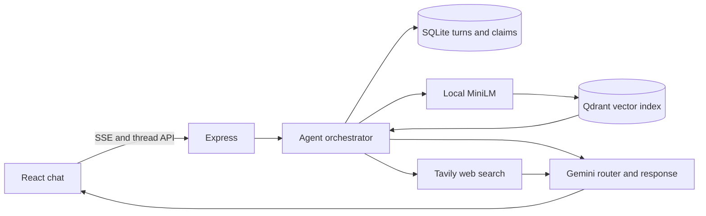
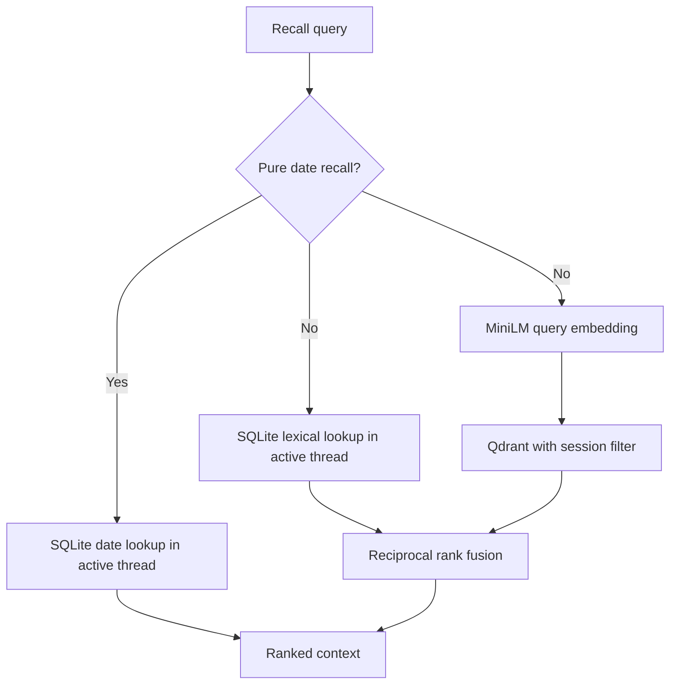

# Kitty design

## Table of contents

1. [What this is](#1-what-this-is)
2. [Core principle](#2-core-principle)
3. [Stack](#3-stack)
4. [Reading path](#4-reading-path)
5. [Repository map](#5-repository-map)
6. [Architecture](#6-architecture)
7. [Agent pipeline](#7-agent-pipeline)
8. [Data model](#8-data-model)
9. [SSE protocol](#9-sse-protocol)
10. [Frontend](#10-frontend)
11. [Configuration](#11-configuration)
12. [Run and test](#12-run-and-test)
13. [Design choices](#13-design-choices)
14. [Failure behavior](#14-failure-behavior)
15. [Limits and performance](#15-limits-and-performance)
16. [Operational notes](#16-operational-notes)
17. [Extending Kitty](#17-extending-kitty)
18. [Glossary](#18-glossary)
19. [Hybrid memory](#19-hybrid-memory)

## 1. What this is

Kitty handles follow-up questions that mix earlier conversations with current facts. It keeps thread history in SQLite, shares extracted claims across one owner's threads, and uses web search to check what has changed.

## 2. Core principle

SQLite is canonical. The server resolves dates and selects memory; Gemini classifies requests and writes answers. The answer model's only tool is `web_search`.

## 3. Stack

| Area | Implementation |
|---|---|
| Server and runtime | TypeScript, Node, Express |
| Models | Gemini through `@google/genai` |
| Web search | Tavily through `fetch` |
| Storage | SQLite through `better-sqlite3` |
| Semantic retrieval | Local `all-MiniLM-L6-v2` embeddings and Qdrant |
| UI | React, Vite, Tailwind, beUI agent components |
| Validation and tests | Zod and Node's test runner |

## 4. Reading path

Read `server/agent/index.ts`, then `router.ts`, `prefetch.ts`, `memory.ts`, and `synthesizer.ts`. Persistence lives in `server/db/`; prompts are in `server/agent/prompts.ts`.

## 5. Repository map

`server/agent/` contains the pipeline; `server/db/` owns SQLite; `server/routes/chat.ts` handles API/SSE; `web/src/` contains the chat UI; `scripts/` and `tests/` contain evaluation tools and fixtures.

## 6. Architecture



## 7. Agent pipeline

`runAgent` saves the user turn, resolves supported UTC dates, and asks the router for intent, entities, and searches. Prefetch supplies recent thread turns and matching claims. Recall requests can retrieve same-thread raw turns and use a separate, non-streamed structured decision for one additional claim lookup. Control JSON never enters the answer stream.

After saving the answer, a bounded worker extracts claims and retries failures, including for older turns. New non-recall turns also save a topic claim for routed entities.

The synthesizer can make up to six `web_search` calls. Results appear as activity and source events; answers render as Markdown.

## 8. Data model

SQLite has `sessions`, `turns`, and `claims`. A session is a thread. Turns store text, timestamps, entities, and indexing/extraction status. Claims store dated entity facts, optional source URLs, and a supporting turn ID.

There is one application owner and no user ID column. Raw turns and Qdrant retrieval are thread-scoped; claims are shared across threads. Multi-user deployment requires user-scoped claims and indexes.

## 9. SSE protocol

`POST /api/chat` streams `plan`, `memory`, `tool`, `token`, and terminal `done`/`error` events. It returns the thread ID in `x-session-id` and times out after 60 seconds.

## 10. Frontend

`/` is a new draft; `/:conversationId` reloads a thread. The client loads history from the API and renders Markdown, search activity, and sources.

## 11. Configuration

Copy `.env.example` to `.env`. Set `GEMINI_API_KEY` and `TAVILY_API_KEY`; `DB_PATH` defaults to `./data/agent.db`. `QDRANT_URL` enables semantic retrieval; `QDRANT_API_KEY` is optional. The default collection is `kitty_turns_minilm384`.

`GEMINI_MODEL_ROUTER`, `GEMINI_MODEL_SYNTH`, and `GEMINI_MODEL_EXTRACT` override the code default `gemini-3.5-flash-lite`. `.env.example` sets `gemini-flash-lite-latest`.

## 12. Run and test

```bash
npm install
cp .env.example .env
# Add Gemini and Tavily keys; start Qdrant for semantic retrieval
npm run dev
```

`npm test` runs the deterministic suite; `npm run test:agent-regression` prints category diagnostics. `npm run typecheck` and `npm run build` check the app. `seed:memory:eval` and `bench:memory` compare SQL and MiniLM on a disposable database.

## 13. Design choices

- **SQLite plus Qdrant:** SQL handles exact/date lookup; rebuildable vectors help with paraphrases.
- **Shared claims:** raw turns stay in the active thread; claims support cross-thread recall for one owner.
- **Local embeddings:** MiniLM avoids a network embedding request; its first load downloads about 25 MB.
- **No framework, memory tool, or cross-encoder:** current bounded TypeScript flows are easier to inspect; evaluation does not justify more machinery.

With another week, I would expand the labeled corpus, investigate low-MRR cases, and measure live provider reliability and latency.

## 14. Failure behavior

Router errors use a deterministic fallback. Recall-decision errors continue with prefetched context; synthesis errors end the stream. Extraction and indexing failures retry. Tavily failures return no results; SQL retrieval remains available if MiniLM or Qdrant fails.

## 15. Limits and performance

The committed 12-case synthetic benchmark reports semantic Hit@8/Recall@8 of 0.667/0.667 for SQL and 1.000/1.000 for MiniLM hybrid. Semantic p50/p95 latency was 0.2/0.4 ms and 59.8/64.3 ms. Temporal scores were 1.000 for both; temporal p50/p95 was 0.1/0.2 ms for SQL and 0.3/0.4 ms for hybrid. See `bench/baseline-2026-11-16.json`; these are local measurements, not production guarantees.

The sample is small; MiniLM ranked one relevant result lower than SQL. Tests mock Gemini, Tavily, and Qdrant, so live reliability is unverified. Cross-thread recall depends on claims being available.

## 16. Operational notes

`server/db/client.ts` adds columns to existing databases. Workers are in-process and bounded. SQLite remains usable without Qdrant; deleting a thread removes its turns and claims, then its vectors.

## 17. Extending Kitty

Keep prompts in `server/agent/prompts.ts`. A new intent also needs router schema/fallback, prefetch behavior, and regression cases. New SSE events must be handled in `AgentEvent`, the route, and `web/src/App.tsx`.

## 18. Glossary

| Term | Meaning |
|---|---|
| Thread / session | One conversation ID |
| Turn | One user or assistant message |
| Claim | A dated entity/attribute/value item linked to a supporting turn |
| Memory block | Bounded turn and claim context supplied to Gemini |
| Hybrid retrieval | Same-thread SQL candidates and MiniLM/Qdrant candidates merged with reciprocal rank fusion |
| Temporal delta | Compare a historical claim with current web evidence |

## 19. Hybrid memory



Qdrant stores normalized 384-dimensional q8 vectors and filter metadata, not message text. SQLite stores source records and pending work. Workers process up to eight embedding turns and two assistant extractions per poll, retrying failures. The old Gemini collection is not queried.

The benchmark reports Hit@8, Recall@8, MRR, and p50/p95 latency, after validating each labeled ID against its thread. Regression fixtures cover cross-thread claims, extraction failures, search planning, dates, and evidence handling.
