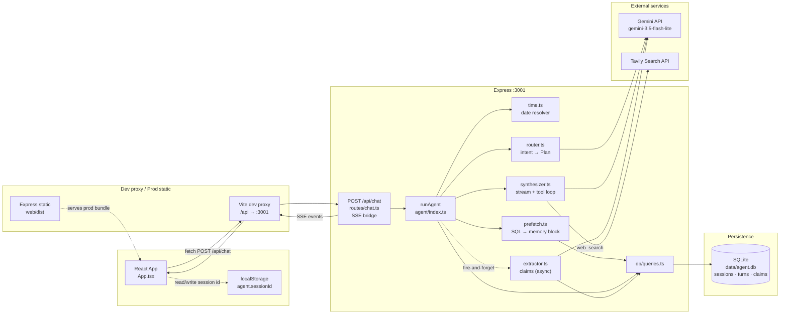
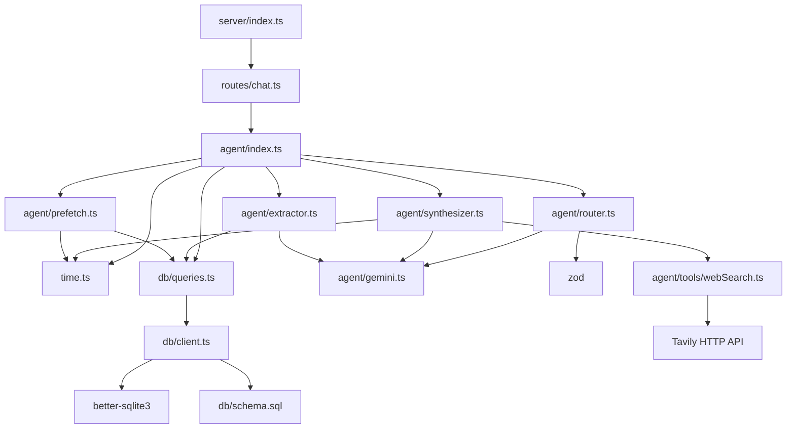
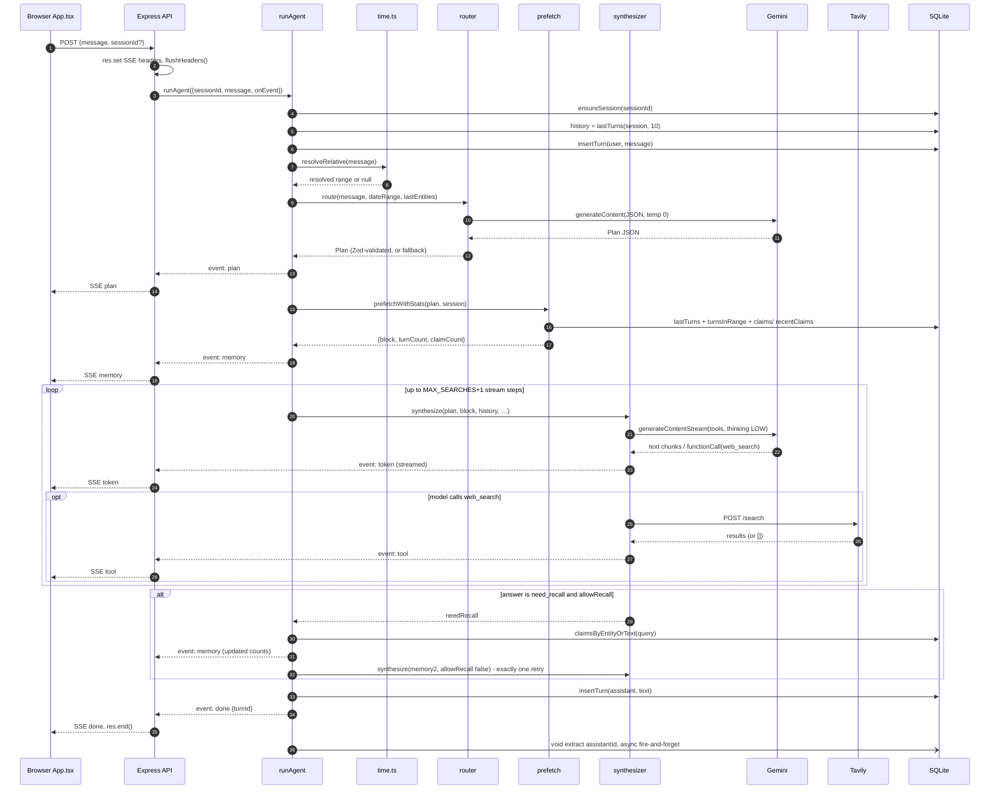
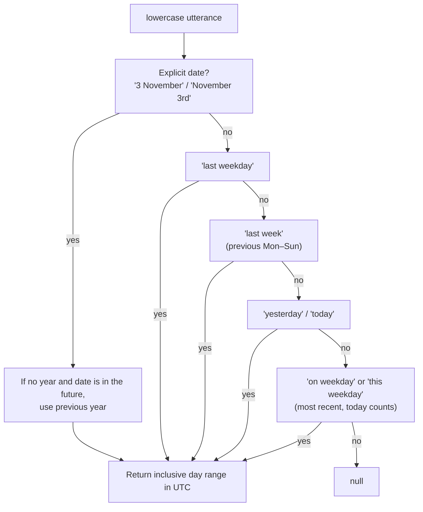
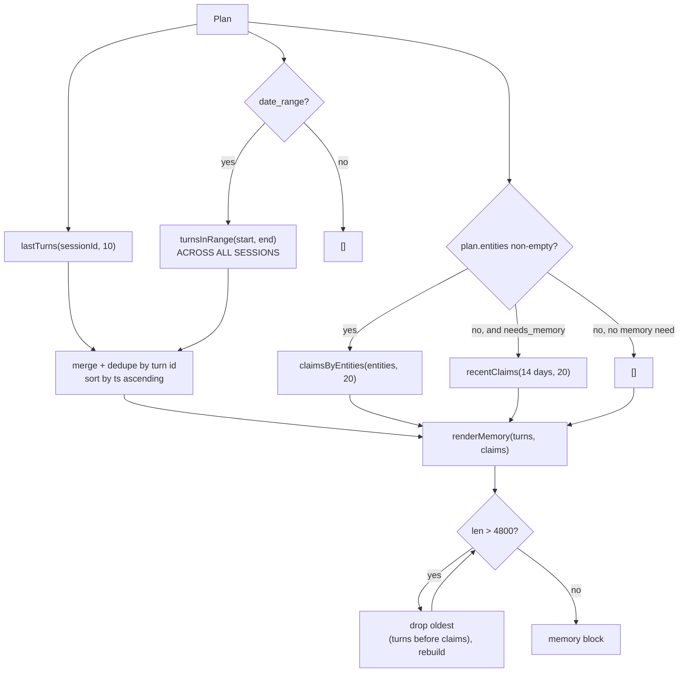
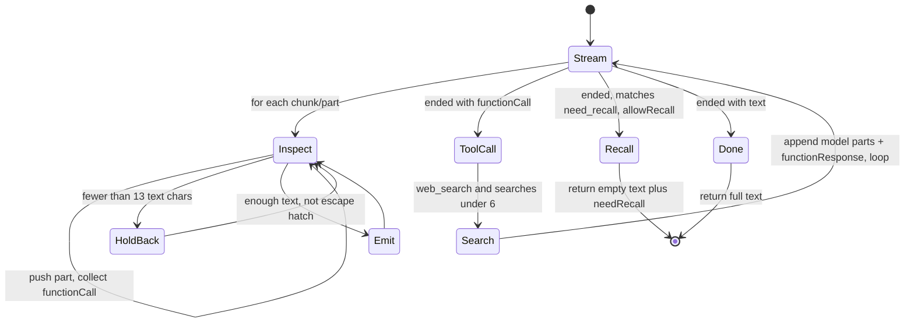
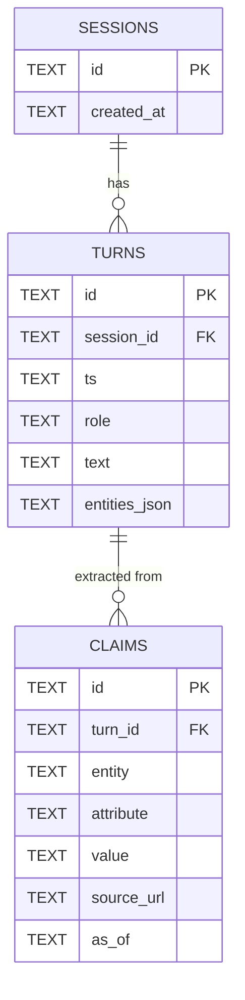
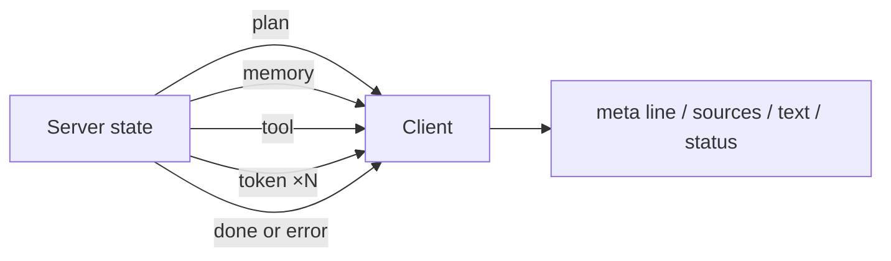

# DESIGN — Temporal Memory Agent

> **One-line thesis:** a chat agent with exactly one tool (`web_search`) whose *memory is assembled by the orchestrator before the model runs* — the LLM never "decides to remember". Time, recall, and claiming are deterministic code paths around a streaming model call.

This document is intended to be a complete mental model of the project. If you read only this file, you should be able to modify, debug, extend, and reason about the system without reading the source first (though the source is small enough that you should).

---

## Table of contents

1. [What this is](#1-what-this-is)
2. [Core design principle: memory is context, not a tool](#2-core-design-principle-memory-is-context-not-a-tool)
3. [Tech stack](#3-tech-stack)
4. [Reading path for an AI agent](#4-reading-path-for-an-ai-agent)
5. [Repository map (every file)](#5-repository-map-every-file)
6. [System architecture](#6-system-architecture)
7. [Request lifecycle (end to end)](#7-request-lifecycle-end-to-end)
8. [The agent pipeline in depth](#8-the-agent-pipeline-in-depth)
   - 8.1 [Time resolver (`server/time.ts`)](#81-time-resolver-servertimets)
   - 8.2 [Router (`server/agent/router.ts`)](#82-router-serveragentrouterts)
   - 8.3 [Prefetch / memory block (`server/agent/prefetch.ts`)](#83-prefetch--memory-block-serveragentprefetchts)
   - 8.4 [Synthesizer (`server/agent/synthesizer.ts`)](#84-synthesizer-serveragentsynthesizerts)
   - 8.5 [Claim extractor (`server/agent/extractor.ts`)](#85-claim-extractor-serveragentextractorts)
9. [Data model](#9-data-model)
10. [SSE protocol](#10-sse-protocol)
11. [Frontend](#11-frontend)
12. [Configuration](#12-configuration)
13. [Running, building, testing](#13-running-building-testing)
14. [Design decisions and why-nots](#14-design-decisions-and-why-nots)
15. [Failure modes and graceful degradation](#15-failure-modes-and-graceful-degradation)
16. [Limits, budgets, and performance](#16-limits-budgets-and-performance)
17. [Sharp edges and gotchas](#17-sharp-edges-and-gotchas)
18. [How to extend safely](#18-how-to-extend-safely)
19. [Glossary](#19-glossary)

---

## 1. What this is

A single-user **temporal memory chat agent**. You ask a question; it answers using:

- the recent conversation,
- dated factual *claims* it previously extracted from earlier answers,
- optional fresh web search results (via Tavily),

and when a question refers to the past — "what did I ask on Monday?", "is that HubSpot pricing still correct?" — it resolves the date **in code**, pulls the relevant prior turns/claims from SQLite, and either recalls or re-verifies them against the web.

It is deliberately tiny: ~15 source files, no vector database, no agent framework. The entire control flow is `server/agent/index.ts`, readable top to bottom in ~50 lines.

---

## 2. Core design principle: memory is context, not a tool

The model has **exactly one tool**: `web_search`.

Recall is **not** a model tool. The orchestrator:

1. resolves relative dates in code (`server/time.ts`),
2. classifies the turn into an intent (`chat | search | recall | temporal_delta`) with a small JSON-producing router call,
3. **prefetches** the relevant memory from SQLite,
4. injects it as a `<memory>…</memory>` block in the synthesizer's system instruction,
5. then streams the answer.

This is the whole point. It avoids:

- the model hallucinating prior turns,
- unbounded "memory search" tool loops,
- vector-similarity fuzziness for what is fundamentally entity/date-keyed structured data.

There is exactly **one** escape hatch: if the model genuinely needs a past claim that was not prefetched, it may emit `{"need_recall": "…"}`; the orchestrator performs a targeted SQL lookup and retries the synthesis **once**. See [§8.4](#84-synthesizer-serveragentsynthesizerts).

---

## 3. Tech stack

| Layer | Choice | Notes |
|---|---|---|
| Runtime | Node.js + TypeScript (ESM) | `"type": "module"`, run via `tsx` |
| HTTP server | Express 4 | one route: `POST /api/chat` |
| LLM | Google Gemini via `@google/genai` | model `gemini-3.5-flash-lite` (lightest tier), thinking level `LOW` |
| Web search | Tavily Search API | plain `fetch`, no SDK |
| Persistence | SQLite via `better-sqlite3` | synchronous, WAL mode, schema auto-applied |
| Validation | Zod | validates router + extractor JSON |
| Frontend | React 18 + Vite 5 | single `App` component, no router, no state library |
| Streaming | Server-Sent Events (SSE) | wire format `event:` / `data:` frames |
| Dev tooling | `concurrently`, `tsx watch`, `node:test` | |

---

## 4. Reading path for an AI agent

If you need to understand or change this project, read in this order:

1. `DESIGN.md` (this file) — the map.
2. `server/agent/index.ts` — the ~50-line orchestrator; the spine of the system.
3. `server/agent/synthesizer.ts` — the only place the answer is produced; tool loop + streaming.
4. `server/agent/router.ts` — intent classification contract.
5. `server/agent/prefetch.ts` — how memory becomes prompt text.
6. `server/db/schema.sql` + `server/db/queries.ts` — the data.
7. `server/time.ts` — date semantics.
8. `server/routes/chat.ts` — SSE transport.
9. `web/src/App.tsx` — how the stream is rendered.
10. `server/agent/extractor.ts` — how claims are written back.

The critical invariant to keep in your head:

> **The model never reads SQL, never picks a date, and never maintains memory. Code does all three; the model only classifies, writes prose, and optionally calls `web_search`.**

---

## 5. Repository map (every file)

```
.
├── .env / .env.example          environment config (see §12)
├── package.json                 scripts + deps (see §3)
├── tsconfig.json                strict TS, ES2022, moduleResolution Bundler, noEmit
├── DESIGN.md                    this document
├── README.md                    quickstart
│
├── server/
│   ├── index.ts                 Express bootstrap: JSON body parser, /api router, static web/dist, listen
│   ├── time.ts                  deterministic date/relative-phrase resolver (UTC)
│   ├── time.test.ts             node:test unit tests for time.ts
│   │
│   ├── routes/
│   │   └── chat.ts              POST /api/chat → SSE bridge around runAgent
│   │
│   ├── agent/
│   │   ├── index.ts             ORCHESTRATOR: runAgent(), the pipeline spine; AgentEvent type
│   │   ├── gemini.ts            shared Gemini client, model getters, thinkingConfig, parseJson()
│   │   ├── router.ts            intent classifier → Plan (Zod), with fallback
│   │   ├── prefetch.ts          SQL → <memory> block, token-budget truncation
│   │   ├── synthesizer.ts       streaming answer + web_search tool loop + need_recall escape hatch
│   │   ├── extractor.ts         async post-turn claim extraction → SQLite
│   │   └── tools/
│   │       └── webSearch.ts     Tavily wrapper + tool declaration
│   │
│   └── db/
│       ├── client.ts            opens better-sqlite3, WAL, FK on, applies schema.sql
│       ├── schema.sql           tables: sessions, turns, claims (+ indexes)
│       └── queries.ts           all SQL accessors and writers
│
└── web/
    ├── index.html               shell + all CSS (inline <style>)
    ├── vite.config.ts           root=web, React plugin, /api proxy → :3001, outDir=dist
    └── src/
        ├── main.tsx             React root mount
        └── App.tsx              chat UI, SSE parser, message state
```

---

## 6. System architecture



### Module dependency graph



---

## 7. Request lifecycle (end to end)

`runAgent()` in `server/agent/index.ts` is the authoritative sequence. Numbers below match the inline comments in that file.



### Step-by-step (authoritative)

1. **`ensureSession(sessionId)`** — insert-or-ignore into `sessions`.
2. **Load history** — `lastTurns(sessionId, 10)` *before* inserting the current message.
3. **Persist user turn** — `insertTurn(sessionId, "user", message)`.
4. **Resolve dates in code** — `resolveRelative(message)`; the LLM never does date math.
5. **Route** — `route(message, dateRange, lastEntities(sessionId))` → `Plan`.
6. **Emit `plan`** — `{intent, entities, dateRange}`.
7. **Prefetch memory** — `prefetchWithStats(plan, sessionId)` → `{block, turnCount, claimCount}`.
8. **Emit `memory`** — `{turnCount, claimCount}`.
9. **Synthesize** — build `run(memoryBlock, allowRecall)` closure that wires `onToken` → `token` events and `onSearch` → `tool` events.
10. **First pass** — `out = await run(pre.block, true)`.
11. **Conditional recall retry** — if `out.needRecall`: fetch `claimsByEntityOrText`, splice recalled lines into the `<memory>` block, emit updated `memory`, then `out = await run(memory2, false)` (no second retry).
12. **Persist assistant turn** — `insertTurn(sessionId, "assistant", out.text)`.
13. **Emit `done`** — `{turnId}`.
14. **Extract asynchronously** — `void extract(assistant.id)`; failures never affect the response.

---

## 8. The agent pipeline in depth

### 8.1 Time resolver (`server/time.ts`)

Pure functions, no LLM, fully unit-tested. Everything is **UTC**.

- `resolveRelative(utterance, now?) → [startISO, endISO] | null`
- `nowIso() → string`
- `todayLabel(now?) → "YYYY-MM-DD (Weekday, UTC)"`

Resolution order:



Semantics (from code + tests):

| Phrase | Meaning |
|---|---|
| `on Monday`, `this Monday` | most recent Monday; **today counts** if today is Monday |
| `last Tuesday` | strictly before today (today is never "last") |
| `last week` | previous Monday–Sunday |
| `yesterday` / `today` | single day |
| `3 November`, `November 3rd` | that day; if no year and it's in the future, roll back one year |
| output | inclusive range, end = end-of-day `23:59:59.999Z` |

The router may echo this range; but the orchestrator **overrides** `plan.date_range` with the code-computed value so date math is never trusted to the model.

### 8.2 Router (`server/agent/router.ts`)

A cheap, non-streaming classification call. `temperature: 0`, `responseMimeType: "application/json"`, thinking `LOW`.

**Contract (`PlanSchema`):**

```ts
{
  intent: "chat" | "search" | "recall" | "temporal_delta",
  entities: string[],                       // default []
  date_range: [string, string] | null,      // default null
  needs_memory: boolean,
  needs_web: boolean,
  search_queries: string[]                  // default []
}
```

Intent semantics:

| Intent | Meaning |
|---|---|
| `chat` | ordinary conversation; no memory/recall dependency |
| `search` | fresh factual lookup, independent of earlier turns |
| `recall` | "what did I say/ask before?" — answer from memory, no web unless also asked if still true |
| `temporal_delta` | references a prior conversation **and** asks whether something changed / is still correct → compare old claim vs fresh web evidence |

The router prompt also says: use `recentEntities` when the user says "them/those"; echo `resolvedDateRange` verbatim; set `needs_memory` for `recall`/`temporal_delta`; generate one `search_query` per entity+attribute for search-type intents.

**Fallback plan** (any failure → logged, never throws to caller):

```ts
{
  intent: resolvedDateRange ? "recall" : "chat",
  entities: recentEntities,
  date_range: resolvedDateRange,
  needs_memory: !!resolvedDateRange,
  needs_web: true,
  search_queries: []
}
```

So even with Gemini down, the system degrades to a memory-aware chat/search attempt rather than failing the request outright.

### 8.3 Prefetch / memory block (`server/agent/prefetch.ts`)

Builds the only memory the model sees, as a single `<memory>` string capped at **~1200 tokens** (`MAX_CHARS = 1200 * 4 = 4800`).



**Rendered format** (exact shape the model sees):

```text
<memory>
Today: 2026-11-15 (Sunday, UTC)

Recent turns:
  [2026-11-15T09:12Z] user: "hello"
  [2026-11-15T09:12Z] assistant: "Hello! How can I help you today?"
  ...

Your prior claims (dated):
  { entity: "HubSpot", attribute: "pricing", value: "...", source: "https://…", as_of: "2026-11-01" }
  ...
</memory>
```

Details:

- Turn lines: timestamp truncated to minutes + `Z`, role, JSON-stringified text, truncated at 400 chars with `…`.
- Claim lines: entity/attribute/value/source (`"unknown"` if null)/`as_of` first 10 chars.
- **Truncation drops oldest first and drains turns before claims**, so dated claims survive longest under budget pressure.
- `prefetchWithStats` is wrapped in `try/catch`; **prefetch never throws** — on error it returns an empty block and zero counts.
- `prefetch()` is a thin `.block`-only wrapper (public convenience; the orchestrator uses `prefetchWithStats`).

### 8.4 Synthesizer (`server/agent/synthesizer.ts`)

The only place prose is generated and the only place a tool is exposed.

Constants:

- `MAX_SEARCHES = 6` (hard cap on web searches per turn)
- `TOOLS = [{ functionDeclarations: [webSearchDecl] }]` — exactly one tool.

**System prompt construction** (`systemPrompt(plan, memoryBlock, allowRecall)`):

- injects `Today` (from `todayLabel`), `intent`, entities, and up to the suggested `search_queries`;
- per-intent rules:
  - `recall` → answer only from `<memory>`, quote prior user message exactly, never invent turns;
  - `temporal_delta` → compare each dated prior claim against fresh web evidence, lead with the answer, label each entity changed/not changed/unverified, cite url + `published_at` or `"undated"`, never invent dates;
  - "is that still correct?" → recall from memory **then** verify with `web_search`;
- escape hatch line: when `allowRecall`, it may output exactly `{"need_recall": "<query>"}` **and nothing else**; when `allowRecall` is false, it must not;
- appends the `<memory>` block.

`contents` = history mapped (`assistant → model`, `user → user`) then the current user message.

**Streaming + tool loop:**



Important mechanics:

- **Part forwarding:** every part is pushed into `parts`, so model turns (including Gemini 3 thought-signature parts) are echoed back intact when a tool call is made.
- **Token hold-back / prefill suppression:** the first emitted text is withheld until at least `PREFIX.length` (13) chars are available, because `{"need_recall"` is a valid JSON prefix. Once it can tell the output is *not* the escape hatch, it emits the whole accumulated `turnText`, then streams subsequent chunks normally. This prevents leaking the control JSON to the user. Short final replies are flushed after the stream if the decision point was never reached.
- **Tool response shape:** each result maps `published_at ?? "undated"`; if there were no results it attaches `note: "no results (search failed or empty)"` so the model can narrate the gap rather than hallucinate.
- **Loop bound:** `for step = 0..MAX_SEARCHES` → at most 6 searches, then tools are withheld (`tools: undefined`) on the final step so the model must answer.
- **Return value:** `{ text, needRecall? }`; `text` is the concatenation of all streamed text across steps.

### 8.5 Claim extractor (`server/agent/extractor.ts`)

Runs **after** the response is sent, fire-and-forget (`void extract(assistant.id)`).

**Contract (`ExtractionSchema`):**

```ts
{
  entities: string[],
  claims: {
    entity: string,
    attribute: string,
    value: string,
    source_url: string | null,
    as_of?: string
  }[]
}
```

Behavior:

1. `getTurn(turnId)`; bail if missing.
2. Take `lastTurns(session, 3)` filtered to `ts <= turn.ts`, join as `role: text`.
3. Gemini `generateContent` (`temp 0`, JSON, thinking `LOW`).
4. Zod-parse; `as_of` defaults to the turn timestamp; `source_url` null if absent.
5. `writeExtraction(...)`:
   - update `turns.entities_json`,
   - delete existing claims for this `turn_id`,
   - insert new claims — all in one transaction (idempotent per turn).
6. Any error is logged, never thrown. A failed extraction simply means no new claims.

The extractor prompt explicitly forbids inventing URLs and asks for *durable, attributable* claims (entity + attribute like "pricing"/"free tier limit") while skipping small talk and opinions.

---

## 9. Data model



- Engine: SQLite, `journal_mode = WAL`, `foreign_keys = ON`.
- `schema.sql` is executed on every process start (`CREATE TABLE IF NOT EXISTS`), so it is idempotent.
- Indexes: `turns(session_id, ts)` and `claims(entity, as_of DESC)`.
- Timestamps are ISO strings (lexicographically sortable; the code relies on `localeCompare`/SQL ordering).
- `entities_json` is a JSON array on the turn; populated by the extractor.

**Query layer (`server/db/queries.ts`)** — all DB access goes through here:

| Function | Purpose |
|---|---|
| `ensureSession(id)` | insert-or-ignore session |
| `insertTurn(sessionId, role, text)` | create a turn, returns it |
| `getTurn(id)` | fetch one turn |
| `lastTurns(sessionId, n)` | last *n* turns, chronological |
| `turnsInRange(start, end, limit=40)` | **all sessions** in a time window, ascending |
| `claimsByEntities(entities, limit=20)` | claims for named entities (case-insensitive) |
| `recentClaims(days, limit=20)` | claims with `as_of` newer than N days |
| `claimsByEntityOrText(q, limit=20)` | LIKE search for the recall escape hatch |
| `lastEntities(sessionId)` | deduped entities from the last 3 non-empty turns |
| `writeExtraction(turnId, entities, claims)` | transactional, idempotent per turn |

Note: `turnsInRange` intentionally crosses sessions — this is a single-user app, so "what did I ask on Monday" should find it regardless of session.

---

## 10. SSE protocol

`POST /api/chat` accepts:

```json
{ "message": "…", "sessionId": "optional-uuid" }
```

Response headers include `Content-Type: text/event-stream`, `Cache-Control: no-cache, no-transform`, `Connection: keep-alive`, and `x-session-id` (echoed/generated UUID; the client persists it).

Each frame is:

```
event: <type>
data: <json>

```

### Event types (`AgentEvent`)

| Event | Data | Emitted when | Client behavior |
|---|---|---|---|
| `plan` | `{intent, entities, dateRange}` | after routing | sets the message `meta` line |
| `memory` | `{turnCount, claimCount}` | after prefetch (and again on recall retry) | appends `mem: N turns, M claims` to `meta` |
| `tool` | `{query, results:[{title,url,published_at}]}` | after each successful search attempt | increments search counter, updates status, appends sources |
| `token` | `{text}` | per streamed text chunk | appends to the assistant bubble |
| `done` | `{turnId}` | after assistant turn persisted | ends the stream |
| `error` | `{message}` | on exception or 60s timeout | appends `[error: …]` |



Transport details (`server/routes/chat.ts`):

- `res.flushHeaders()` immediately so the client starts reading.
- `send()` ignores events after `finished` or `res.writableEnded`; `done`/`error` end the response and clear the timeout.
- A **60-second** timer sends an `error` event (`"timeout after 60s"`).
- Cancellation listens on **`res.on("close")`** — not `req.on("close")`. (See [§17](#17-sharp-edges-and-gotchas); using `req` silently drops all events because the request body completes in ~1 ms.)
- The orchestrator runs to completion even if the client disconnects; `finished` only suppresses writes.

### Client parsing (`web/src/App.tsx`)

- `fetch` the endpoint, read `res.body.getReader()`, decode with `TextDecoder({stream:true})`.
- Accumulate a buffer; split frames on `\n\n`; parse `event:` and `data:` with regex; `JSON.parse` the data.
- `patchLast()` immutably updates the **last** message (the in-progress assistant bubble).
- `x-session-id` is stored in `localStorage["agent.sessionId"]`.

---

## 11. Frontend

Single component, no routing, no state library.

State:

- `msgs: Msg[]` — `{role, text, sources?, meta?}`; while streaming, the last assistant message is mutated via `patchLast`.
- `input`, `status` (`"thinking…"`, `"searching N queries…"`, `"writing…"`), `busy`.
- `endRef` for auto-scroll (`useEffect` with a **block body** — a concise arrow that returns `scrollIntoView()`'s value triggers React's "detect is not a function" crash).

Rendering:

- user/assistant bubbles (`white-space: pre-wrap`),
- assistant `meta` line (intent + entities + memory stats),
- collapsible `<details>` per assistant message listing sources (title · published_at/undated · URL),
- status line, composer (Enter sends, Shift+Enter newline), send button disabled while busy/empty.

All CSS lives in `web/index.html` (`<style>`), using `color-scheme: light dark`.

Behavioral notes for anyone changing the UI:

- The assistant placeholder shows `…` only while `busy` and it is the last message.
- If the stream fails before `done`, the `catch` appends `[error: …]` **to the assistant bubble**, not a toast.
- The client never sends `history`; the server owns conversation state via `sessionId`.

---

## 12. Configuration

Environment (`.env`, loaded by `dotenv` in `server/index.ts` — imported before anything else):

| Variable | Required | Default | Purpose |
|---|---|---|---|
| `GEMINI_API_KEY` | **yes** | `""` | Google AI Studio key (`AIza…`). A Groq key (`gsk_…`) will 400. |
| `GEMINI_MODEL_ROUTER` | no | `gemini-3.5-flash-lite` | router model |
| `GEMINI_MODEL_SYNTH` | no | `gemini-3.5-flash-lite` | synthesizer model |
| `GEMINI_MODEL_EXTRACT` | no | `gemini-3.5-flash-lite` | extractor model |
| `TAVILY_API_KEY` | yes (for web) | `""` | Tavily bearer token |
| `PORT` | no | `3001` | Express listen port |
| `DB_PATH` | no | `./data/agent.db` | SQLite path (dir auto-created) |

Model/client setup (`server/agent/gemini.ts`):

- `ai = new GoogleGenAI({ apiKey: process.env.GEMINI_API_KEY ?? "" })`
- `thinkingConfig = { thinkingLevel: ThinkingLevel.LOW }` is applied to **all** calls (router, synthesizer, extractor). `gemini-3.5-flash-lite` is the lightest tier and supports `minimal|low|medium|high`.
- `parseJson(raw)` strips ``` fences and parses, used by router/extractor.

Non-obvious: `dotenv/config` is imported first in `server/index.ts`; because `gemini.ts` reads `process.env` at module load, ordering matters if you refactor the bootstrap.

---

## 13. Running, building, testing

```bash
cp .env.example .env      # add GEMINI_API_KEY + TAVILY_API_KEY
npm install
npm run dev               # server :3001 + web :5173 (Vite proxies /api)
npm test                  # time resolver unit tests (node:test)
npm run typecheck         # tsc --noEmit (strict)
npm run build             # Vite → web/dist
npm start                 # tsx server/index.ts (serves web/dist if present)
```

Scripts:

| Script | Command |
|---|---|
| `dev` | `concurrently "tsx watch server/index.ts" "vite --config web/vite.config.ts"` |
| `build` | `vite build --config web/vite.config.ts` |
| `start` | `tsx server/index.ts` |
| `test` | `tsx --test server/time.test.ts` |
| `typecheck` | `tsc --noEmit` |

Production: `npm run build` then `npm start`; Express serves `web/dist` and falls back to `index.html` for non-`/api` routes. In dev, Vite serves the SPA and proxies `/api` to `:3001`.

---

## 14. Design decisions and why-nots

Each choice is deliberate; keep these when changing the system.

### Why a router call instead of one big prompt?

Separating classification (`route`) from synthesis lets memory prefetch be **SQL**, not model-driven. The router output is a small, Zod-validated object; failures degrade to a deterministic fallback. Cost is one cheap lite-model call per turn.

### Why no vector database?

Queries are **entity/date-keyed**. Structured claims in SQLite are exact, diffable, and auditable. Vector similarity would add fuzziness and infra for no gain on this workload.

### Why no LangChain / LangGraph / agent framework?

The control flow is ~50 lines in `server/agent/index.ts`, readable top to bottom. A framework would hide the one thing that matters and add a dependency surface.

### Why is `web_search` the only tool?

Every additional tool is a new way for the model to go off-script. Recall is orchestrator-owned; search is the only thing that genuinely needs the model's judgement about *what to look up*.

### Why the `need_recall` escape hatch, bounded to one retry?

Prefetch is a best-effort budgeted guess. Occasionally the model needs a claim that wasn't included. Rather than allow arbitrary memory tool calls, it may request one targeted recall, which the orchestrator fulfills from SQL and feeds back — then `allowRecall` is disabled so it cannot loop.

### Why dates in code?

LLMs are unreliable at "last Tuesday" arithmetic and prone to inventing dates. `server/time.ts` is deterministic and unit-tested; the router is only allowed to *echo* the resolved range, and the orchestrator overrides it regardless.

### Why claims at all, if turns are stored?

Turns capture language; **claims capture assertable facts** (entity + attribute + value + date + source). Claims are what make "is this still correct?" tractable: compare the dated claim to fresh evidence instead of re-parsing prose.

### Deliberate non-goals

- No auth / multi-tenancy (single user).
- No fine-tuning.
- No reasoning-trace streaming (only tokens + source events; thinking is `LOW` and thoughts are not included).
- No client-side conversation history (server owns it via `sessionId`).
- No message editing / branching.

---

## 15. Failure modes and graceful degradation

| Failure | Where handled | Effect |
|---|---|---|
| Missing/invalid Gemini key | router catch → fallback plan; synthesizer throws → `error` event | Degraded routing; answer fails visibly with `[error: …]` |
| Gemini 503 high demand | router catch → fallback; synthesizer throws → `error` event | Same as above; retry later |
| Router returns invalid JSON | Zod throws → caught → fallback plan | Pipeline continues with heuristic plan |
| Prefetch/SQL error | `try/catch` in `prefetchWithStats` | Empty memory block, zero counts; answer still streams |
| Tavily error / non-200 / timeout (8s) | `webSearch` returns `[]` | Model told "no results"; narrates the gap |
| No search results | `functionResponse.note` set | Model cannot cite; should state it couldn't verify |
| Extractor failure | logged only | No new claims; user response unaffected |
| Client disconnects | `res.on("close")` sets `finished` | Writes suppressed; agent still completes and persists |
| Model stalls | 60s route timer | `error: "timeout after 60s"`, stream ends |
| Search loop runaway | `MAX_SEARCHES = 6`, tools withheld after | Forced final answer |

A key property: **only synthesis failure reaches the user as an error.** Everything else degrades quietly into either a heuristic plan, an empty memory block, or a narrated gap.

---

## 16. Limits, budgets, and performance

| Budget | Value | Location |
|---|---|---|
| Web searches / turn | 6 | `MAX_SEARCHES` |
| Memory block | ~1200 tokens (`4800` chars) | `MAX_CHARS` |
| History sent to synth | 10 turns | `lastTurns(sessionId, 10)` |
| Claims prefetched | 20 | `claimsByEntities` / `recentClaims` |
| Extract context | last 3 turns | `lastTurns(sessionId, 3)` |
| Tavily results / query | 5 (max param) | `webSearch` |
| Tavily timeout | 8s | `AbortSignal.timeout(8000)` |
| Request timeout | 60s | `routes/chat.ts` |
| Router/extractor temperature | 0 | deterministic |
| Synthesizer temperature | 0.3 | slightly natural prose |
| Thinking level | `LOW` | `gemini.ts` |

Practical latency (from a local probe): routing + prefetch + a short `gemini-3.5-flash-lite` answer ≈ **2–3 s**; longer answers stream token events as they arrive. Search turns add one Tavily round-trip (~hundreds of ms to a few seconds) per query, up to 6.

---

## 17. Sharp edges and gotchas

Read this before touching the affected files.

1. **Never listen for SSE cancellation on `req`.** `req.on("close")` fires when the request body finishes (~1 ms with `express.json`), which would set `finished = true` and silently drop every event. Use `res.on("close")` (`server/routes/chat.ts`). This exact bug previously caused "no response, no error".

2. **`useEffect` must not return a value that isn't a cleanup function.** Writing `useEffect(() => ref.current?.scrollIntoView(...), [deps])` returns the call's result and React throws *"destroy is not a function"*. Always use a block body (`web/src/App.tsx`).

3. **The synthesizer deliberately withholds the first ~13 chars.** `PREFIX = '{"need_recall"'`. Do not "simplify" this away; it prevents streaming the control JSON to the user and is what makes the escape hatch invisible.

4. **Thought signatures must survive tool loops.** When the model calls a tool, all response parts (including Gemini 3 thought-signature parts) are appended back as the `model` turn before the `functionResponse`. Stripping non-text parts can break multi-step tool calls.

5. **Date math is code-owned.** Even though the router returns `date_range`, the orchestrator overwrites it with `resolveRelative`'s result. Don't trust the model here.

6. **Extraction is idempotent per `turn_id`.** `writeExtraction` deletes then reinserts in a transaction. Re-running extraction for a turn is safe.

7. **`turnsInRange` intentionally crosses sessions.** It is not a bug; it's what makes "what did I ask on Monday" work in a single-user app. Adding multi-tenancy requires scoping it by user.

8. **The client mutates only the last message.** `patchLast` assumes events always target the newest assistant bubble. Any change that emits events for older messages will misrender.

9. **API key prefix sanity:** Gemini keys start `AIza…`. A `gsk_…` key is Groq and yields `API_KEY_INVALID`.

10. **Model default is pinned in code *and* overridable by env.** `.env` values win. If a model is unavailable, the env values are what actually change behavior.

11. **`dotenv/config` ordering:** it must be the first import in the server entry so `gemini.ts` sees `GEMINI_API_KEY` at module evaluation.

12. **SSE frames are exactly `\n\n`-terminated** and the client regex-parses `event:`/`data:`. Changing the separator or adding multi-line `data:` breaks parsing.

---

## 18. How to extend safely

### Add a new intent

1. Add it to `intent` enum in `PlanSchema` (`router.ts`).
2. Document it in the router `SYSTEM` prompt.
3. Handle it in `systemPrompt()` in `synthesizer.ts`.
4. Decide its prefetch behavior in `prefetch.ts` (which claims/turns it needs).
5. Update the fallback plan only if it should ever be auto-selected.
6. Add a test path or manual verification query.

### Change the memory policy

Everything lives in `prefetch.ts`: `MAX_CHARS`, merge/dedupe, claims selection, truncation order. Keep the `prefetch never throws` guarantee.

### Change the model / thinking level

Edit `gemini.ts`. Keep `thinkingConfig` applied uniformly; for Gemini 2.5 models you'd need `thinkingBudget` instead of `thinkingLevel` (do not send both — the API returns 400).

### Add a tool (discouraged)

You must: add the declaration, extend `TOOLS`, handle `call.name` in the synthesizer loop, and fund the loop bound. Remember the design thesis — recall is not a tool. Prefer extending prefetch over adding memory tools.

### Add persistence fields

Change `schema.sql` (idempotent `CREATE … IF NOT EXISTS` won't migrate existing columns — you'd need an `ALTER TABLE` guard or a migration), then update `queries.ts` and any mappers. Note `better-sqlite3` is synchronous; keep queries fast and out of hot loops.

### Add an SSE event

1. Extend the `AgentEvent` union in `agent/index.ts`.
2. Emit it from the orchestrator/synthesizer.
3. Handle it in `App.tsx`'s parser (`else if (event === "...")`).
4. Keep `done`/`error` as terminal events (they end the response).

---

## 19. Glossary

| Term | Meaning |
|---|---|
| **Plan** | Router output: intent, entities, date range, memory/web needs, suggested queries |
| **Intent** | `chat` / `search` / `recall` / `temporal_delta` |
| **Claim** | A dated, sourced factual assertion about an entity+attribute, stored in SQLite |
| **Memory block** | The `<memory>…</memory>` string prefetched and injected into the system prompt |
| **Prefetch** | Deterministic SQL selection + rendering of turns/claims before synthesis |
| **Synthesizer** | Streaming model call with the single `web_search` tool |
| **Escape hatch (`need_recall`)** | Model's one-shot request for a specific past claim, fulfilled by SQL, then retried once |
| **Temporal delta** | Comparing a prior dated claim against fresh web evidence to answer "is this still true?" |
| **Thinking level** | Gemini 3 reasoning tier; fixed to `LOW` here |
| **SSE** | Server-Sent Events; the streaming transport used by `POST /api/chat` |
| **Turn** | One persisted user or assistant message row |
| **Session** | A conversation id, stored client-side and echoed via `x-session-id` |

---

### TL;DR of the whole system

```
user text
  → resolve date (code)
  → classify intent (cheap JSON LLM call)
  → fetch relevant turns + dated claims (SQL, ~1200-token block)
  → stream answer (one tool: web_search, ≤6 calls, optional one-shot need_recall)
  → send SSE tokens/sources
  → asynchronously extract durable claims back into SQLite
```

Memory is context, not a tool. Code owns dates and recall; the model owns prose and search queries.
