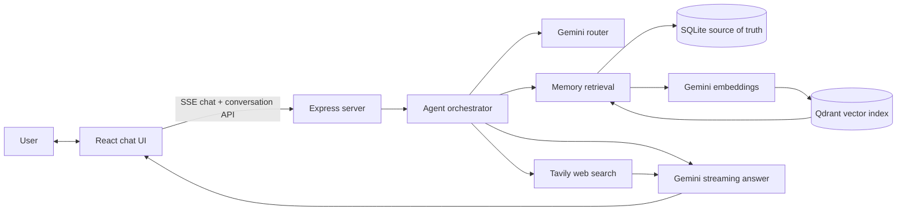
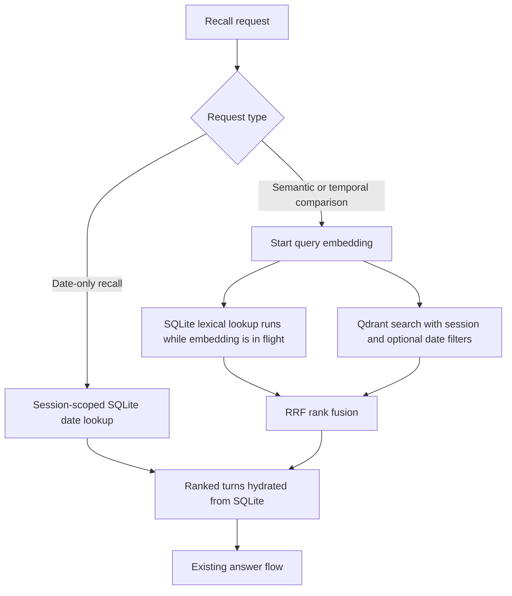

# Kitty

Kitty is a conversational assistant with live web search and long-term conversation recall. It streams answers to the chat UI, shows sources, and keeps conversation history in SQLite. Semantic recall combines SQLite search with a Qdrant vector index.

## Features

- Streaming assistant responses with web-search activity and linked sources.
- Conversation threads that can be resumed, created, and deleted.
- Hybrid recall using recent context, lexical and temporal SQLite queries, and semantic Qdrant retrieval.
- Persistent local conversation and claim data in SQLite.
- Responsive chat UI built with React and beUI components.

## Architecture



### Recall flow



SQLite is canonical. Qdrant is a rebuildable index; pending turns are indexed in the background, and SQL retrieval remains available if the vector service is unavailable.

## Requirements

- Node.js 20 or newer
- Gemini API key
- Tavily API key for web search
- Docker Compose for local Qdrant semantic retrieval

## Run locally

```bash
cp .env.example .env
# Set GEMINI_API_KEY and TAVILY_API_KEY in .env
npm install
docker compose up -d qdrant
npm run dev
```

Open [http://localhost:5173](http://localhost:5173). The Vite development server proxies API requests to Express on port `3001`.

Qdrant is configured for local development at `http://localhost:6333`. Leave `QDRANT_API_KEY` empty for the local container. Set `QDRANT_URL` and `QDRANT_API_KEY` when using a secured remote Qdrant instance. Without Qdrant, normal chat and SQLite-based recall continue to work, but semantic retrieval is disabled.

## Commands

| Command | Purpose |
| --- | --- |
| `npm run dev` | Start the API and Vite development server |
| `npm run typecheck` | Check TypeScript types |
| `npm test` | Run unit tests |
| `npm run build` | Build the production web app |
| `npm start` | Run Express and serve the built app |
| `npm run bench:memory -- path/to/cases.json` | Compare SQL-only and hybrid recall metrics on labeled cases |

The memory benchmark reports Hit@8, Recall@8, MRR, and p50/p95 latency for semantic and pure temporal cases. It requires `GEMINI_API_KEY`, `QDRANT_URL`, a running database, and labeled turn IDs; see [`scripts/memory-eval.example.json`](scripts/memory-eval.example.json) for the case format.

## Configuration

Copy [`.env.example`](.env.example) to `.env` and set the required API keys. `DB_PATH` defaults to `./data/agent.db`; Qdrant collection and embedding model settings are also documented in the example file.

## Project notes

- [`DESIGN.md`](DESIGN.md) describes the request lifecycle, data model, SSE events, memory behavior, and failure handling.
- Conversation turns and claims are stored in SQLite. Qdrant stores turn vectors and filtering metadata only.
- Local database files and environment secrets should not be committed.
