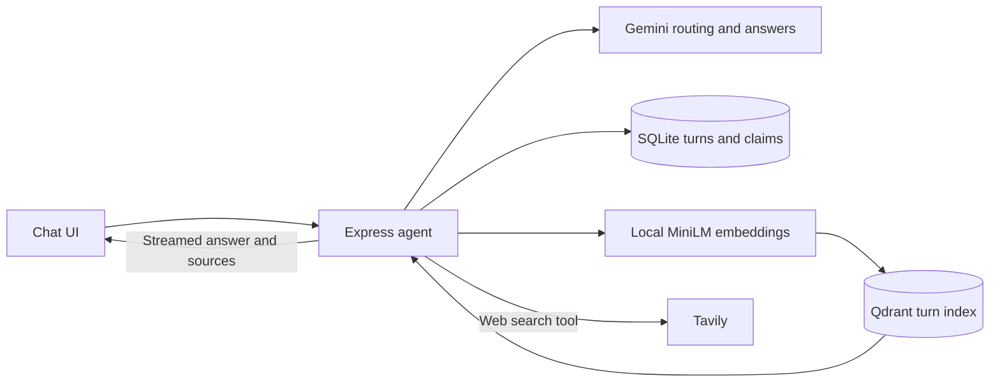

# Kitty

Kitty answers questions with web search and can check whether an answer from a past conversation still holds.

[Architecture](#architecture) · [Tech Stack](#tech-stack) · [Run locally](#run-locally) · [Design notes](DESIGN.md)

## What it does

Ask a current question, revisit something you discussed on a specific date, or ask what changed since a previous answer. Kitty streams its reply and shows links to the sources it found. Each conversation has its own URL; the home page starts a draft and saves it as a thread when you send the first message.

## Example conversations

These exchanges summarize the [regression fixtures](tests/fixtures/agent-regression.json) and [date rules](server/time.ts). Prices and sources in the fixtures are test data. For a quick live check, seed a similar conversation in the UI, then try each follow-up and inspect the sources yourself.

**Recall a specific date — stay in the same thread.**

> **You:** What happened in my October 22 memory discussion?
>
> **Kitty:** We discussed the MiniLM migration and decided the old Qdrant collection should never be used as a fallback.

**Check what changed — open a new thread after the earlier conversation.**

> **You, earlier:** What is the pricing for Postgres hosting?
>
> **Kitty:** About $5–$9/month for entry-level paid plans and $15–$30/month for small production setups.
>
> **You, in a new thread:** Last time I asked you about Postgres hosting. Has any pricing changed since then?
>
> **Kitty:** In the November 15 snapshot, Heroku Basic is still $5/month. The November 14 Neon snapshot lists a $19/month Launch plan, which isn’t directly comparable to the earlier range. I couldn’t verify a change for the other providers.
>
> **Fixture sources:** Heroku pricing snapshot (November 15, 2026); Neon pricing snapshot (November 14, 2026).

**Resolve an ambiguous date — try both phrasings on a Monday.**

> **You:** What did I ask on Monday?
>
> **Kitty’s lookup:** Checks today’s UTC date.
>
> **You:** What about last Monday?
>
> **Kitty’s lookup:** Checks the previous Monday. An explicit date is best if you meant a different week.

**Answer a fresh question — start a blank thread.**

> **You:** What is the current published price in the fixture?
>
> **Kitty:** The November 15 price snapshot lists $120.
>
> **What to check live:** Ask for a provider’s current price. Look for a fresh search and a source link, without an older conversation being pulled in for comparison.

## How it works

1. The server resolves dates in UTC and uses Gemini to classify the request as chat, search, recall, or a comparison with the past.
2. The agent supplies recent context and matching claims from SQLite. A date lookup can use SQLite alone; semantic recall combines SQLite text matches with Qdrant results for the active thread. Extracted claims are available across threads.
3. Gemini streams the answer. Its only tool is web search, via Tavily. Searches requested together run in parallel, up to six searches per response. SQLite saves the conversation, and background workers handle claim extraction and vector indexing.

## Architecture



### Tech Stack

TypeScript and Node.js on the server, React and Vite in the browser, Gemini for routing and answers, Tavily for search, SQLite for storage, and local MiniLM with Qdrant for semantic recall.

## Run locally

Use Node.js 24 and install Docker with the Compose plugin to run Qdrant locally.

```bash
cp .env.example .env
# Set GEMINI_API_KEY and TAVILY_API_KEY in .env
npm install
docker compose up -d qdrant
npm run dev
```

Open [localhost:5173](http://localhost:5173). The Docker Compose step starts Qdrant at `http://localhost:6333`, which matches `QDRANT_URL` in `.env.example`. Leave `QDRANT_API_KEY` blank for the local container. The first MiniLM load downloads about 25 MB; subsequent runs use the cache.

For SQLite recall only, clear `QDRANT_URL` in `.env` and skip the Docker Compose step.

## Environment variables

| Variable | What to set |
| --- | --- |
| `GEMINI_API_KEY` | Gemini API key for routing, answers, and claim extraction. |
| `TAVILY_API_KEY` | Tavily API key for live web search. |
| `QDRANT_URL` | Optional. Use `http://localhost:6333` for the local container. |
| `QDRANT_API_KEY` | Leave blank for local Qdrant. Set for an authenticated HTTPS endpoint. |
| `QDRANT_MINILM_COLLECTION` | Optional index name; defaults to `kitty_turns_minilm384`. |
| `DB_PATH`, `PORT` | Optional; defaults are `./data/agent.db` and `3001`. |
| `GEMINI_MODEL_ROUTER`, `GEMINI_MODEL_SYNTH`, `GEMINI_MODEL_EXTRACT` | Optional model overrides. See [`.env.example`](.env.example). |

## Evaluation

- `npm test` runs the test suite. `npm run test:agent-regression` prints category results and retrieval diagnostics. It uses an isolated database and mocked services; no API keys are needed.
- `npm run typecheck` checks TypeScript; `npm run build` builds the web app.
- The [committed benchmark](bench/baseline-2026-11-16.json) compares SQL and MiniLM on the same synthetic corpus. On nine semantic cases, Recall@8 rose from 0.667 to 1.000 and MRR from 0.500 to 0.639. These are retrieval results on a small corpus. See [DESIGN.md](DESIGN.md#5-evaluation) for latency and test limits.

To rerun the benchmark, start Qdrant and use a disposable database and a fresh collection:

```bash
export DB_PATH="$(mktemp -d)/kitty-eval.db"
export QDRANT_URL=http://localhost:6333
export QDRANT_MINILM_COLLECTION="kitty_eval_$(date +%s)"
npm run seed:memory:eval -- scripts/memory-eval.corpus.json
npm run bench:memory -- scripts/memory-eval.corpus.json
```

## Project structure

| Path | Start here for |
| --- | --- |
| [`server/agent/`](server/agent/) | Routing, prompts, retrieval, and answer streaming |
| [`server/db/`](server/db/) | SQLite schema and queries |
| [`server/routes/`](server/routes/) | Chat and conversation endpoints |
| [`web/src/`](web/src/) | Chat UI and conversation navigation |
| [`scripts/`](scripts/) · [`tests/fixtures/`](tests/fixtures/) | Benchmarks and labeled conversations |

## Limitations

- Kitty is designed for one owner. Raw transcripts stay in their original thread; cross-thread recall depends on extracted claims. A new thread may find the discussion topic before it has the details.
- Dates use UTC and fixed rules for relative phrases. Kitty has no per-user time zone.
- Live search can return stale, incomplete, or conflicting evidence. The deterministic tests check how the pipeline handles fixtures; they don’t establish live answer accuracy.
